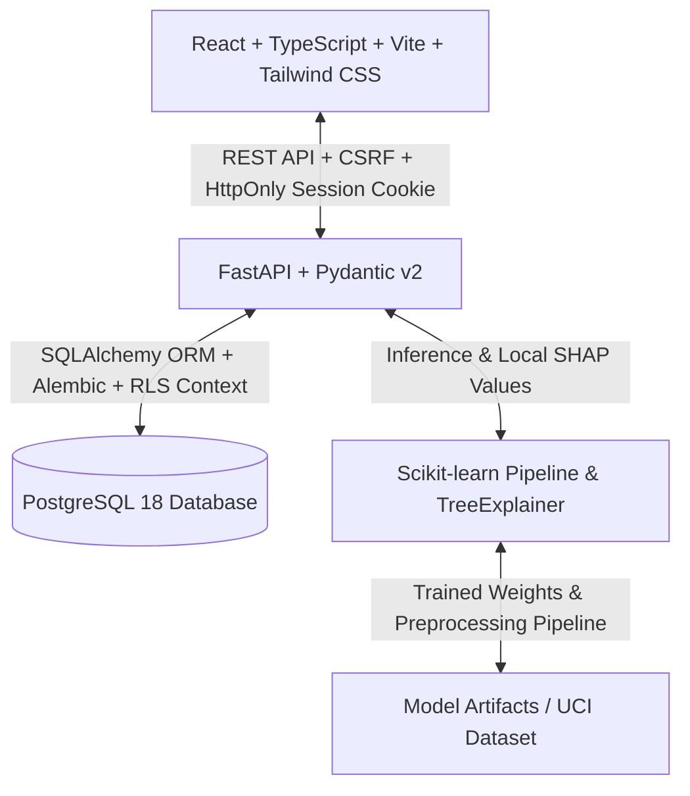

# Implementation Plan: Student Success Early-Warning System
**Explainable AI for Student Dropout Prediction**

## 1. Project Architecture Overview

## 2. Technology & Environment Verification
- **Python**: Python 3.12 (`.venv` virtual environment configured)
- **Node.js**: v24.16.0, npm 11.13.0
- **Database**: PostgreSQL 18 running on port 5433 (database: `student_success`) with SQLite fallback for offline environments.
- **ML Frameworks**: Scikit-Learn, Pandas, NumPy, SHAP (with TreeExplainer/permutation fallbacks).
- **Frontend Stack**: Vite + React 18 + TypeScript + Tailwind CSS + Recharts + Lucide Icons + React Router v6.

## 3. Implementation Stages

### Stage 1: Scaffolding, Planning & Environment Setup
- Verify Python 3.12, PostgreSQL 18, and Node.js toolchains.
- Create backend and frontend folder structures and configuration files.

### Stage 2: Visual Design System & Frontend Shell
- Design system: Charcoal palette (`#202020`, `#282828`, `#303030`, `#19B5D5` cyan accent, accessible alerts).
- Navigation shell, sidebar, top header, landing page, and all core page scaffolds.

### Stage 3: Backend Core, Database, RLS & Authentication
- SQLAlchemy models: Users, Roles, Students, Academic Assessments, Predictions, Interventions, Notes, Import Jobs, Audit Logs, MFA credentials, Session revocations.
- Security: Argon2id password hashing, TOTP MFA (PyOTP), HttpOnly session cookies, CSRF double-token protection, Rate limiting.
- PostgreSQL Row-Level Security (RLS) policies and session context switching.

### Stage 4: Machine Learning Pipeline & Explainability (XAI)
- UCI Student Dropout dataset loader, validation, and stratified train/test split.
- Logistic Regression baseline & Random Forest model.
- Model serialization, evaluation metrics (multiclass precision, recall, F1, confusion matrix).
- SHAP (SHapley Additive exPlanations) for global and local student-level feature importance with positive/negative attribution.

### Stage 5: Frontend & Backend Integration
- Connect all pages to real REST API endpoints (`/api/v1/*`).
- Real-time prediction workspace with instant explanation breakdown and history logging.

### Stage 6: Interventions, Analytics, CSV Import & Audit System
- Student directory with search, filter, pagination, profile drawer.
- Support intervention management with status tracking and faculty notes.
- CSV import with validation, duplicate detection, preview, and error reporting.
- Analytics page with interactive Recharts, confusion matrix, and class metrics.
- Administrator audit log viewer and model information sheet.

### Stage 7: Comprehensive Security Hardening (20 Requirements)
- Implement and verify all 20 mandatory security controls with automated test cases.
- PostgreSQL RLS policy verification using restricted non-superuser application connection.

### Stage 8: Automated Testing, Production Build & Documentation
- Pytest backend test suite (Auth, RLS, BOLA, SQLi, XSS, CSRF, Rate Limiting, ML).
- Vitest frontend test suite and Vite production bundle verification.
- Documentation: `README.md`, `SECURITY.md`, `.env.example`, verification checklist.
