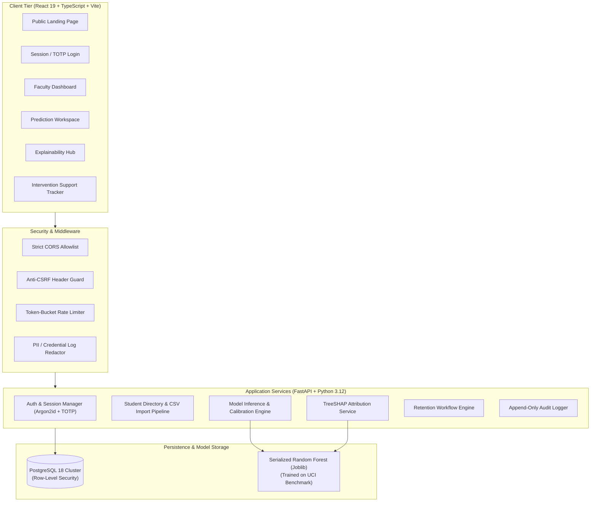

# Student Success Early-Warning System (Explainable AI for Student Dropout Prediction)

[](https://python.org)
[](https://fastapi.tiangolo.com)
[](https://react.dev)
[](https://www.postgresql.org)
[](https://shap.readthedocs.io)

An academic technology platform designed for faculty, mentors, and academic advisors to identify students vulnerable to dropping out early, understand the specific academic and socioeconomic factors driving the prediction via Explainable AI (XAI), and implement proactive retention interventions.

Built for **SIH-style evaluation** and university engineering project demonstrations with production-grade engineering standards: zero-trust security architecture, PostgreSQL Row-Level Security (RLS), TreeSHAP feature explanations, Argon2id hashing, TOTP MFA, and double-submit anti-CSRF token verification.

---

## 🏛️ System Architecture



---

## 🌟 Key Capabilities & Features

### 1. Explainable AI (XAI) as a Core Differentiator
- **TreeSHAP Local Attributions**: Every inference breaks down specific risk drivers (e.g., failed 1st/2nd semester curricular units, tuition delinquency) and protective factors (e.g., high admission grades, scholarship support).
- **Ethical Faculty Guidance**: Distinguishes **correlation from causation**, emphasizing that model attributions reflect statistical patterns in historical training data rather than deterministic judgements.
- **Calibrated Multi-Class Outcomes**: Outputs calibrated probability estimates across three distinct academic trajectories: `Dropout`, `Enrolled`, and `Graduate`.

### 2. Validated Machine Learning Pipeline
- Trained on the official **UCI "Predict Students' Dropout and Academic Success"** benchmark (4,424 student records).
- Evaluated on a strictly held-out **20% stratified test split**:
  - **Overall Accuracy**: `74.80%`
  - **Macro F1-Score**: `70.80%`
  - **Dropout-Class F1-Score**: `76.39%` (Class-weighted to protect against imbalanced attrition false-negatives).
- Temporal leakage prevention: only features available during the targeted prediction semester are included.

### 3. Faculty Dashboard & Retention Workflows
- **Real-Time Risk Categorization**:
  - `High Risk`: Requires immediate faculty review and prioritized support.
  - `Medium Risk`: Monitor academic trajectory and consider study planning.
  - `Low Risk`: Continue routine mentoring.
- **Actionable Interventions**: Faculty can schedule and track academic tutoring, mentoring check-ins, study planning, financial aid guidance, and confidential notes.

### 4. Zero-Trust Security Architecture
- **PostgreSQL Row-Level Security (RLS)**: Enforces table-level row isolation so that confidential faculty notes cannot be viewed by unauthorized staff.
- **Multi-Factor Authentication (TOTP)**: PyOTP-powered two-factor authentication with single-use hashed backup recovery codes.
- **Argon2id Password Hashing**: State-of-the-art resistance against GPU/ASIC password cracking.
- **Double-Submit Anti-CSRF Token Guard**: Prevents cross-site request forgery attacks on state-changing operations.
- **Automated PII/Credential Log Redaction**: Sensitive attributes (`password`, `mfa_secret`, `session_token`, `authorization`) are stripped before logging.

---

## 🚀 Quickstart & Setup Guide

### Prerequisites
- **Python 3.12+**
- **Node.js 18+ & npm**
- **PostgreSQL 14+** (Runs automatically on port `5433` or `5432`, with automatic SQLite fallback if offline).

### 1. Backend Setup & Database Migration

```powershell
# Navigate to backend directory
cd backend

# Create virtual environment (if not already created)
python -m venv .venv
.\.venv\Scripts\Activate.ps1

# Install locked dependencies
pip install -r requirements.txt

# Copy environment template
cp ..\.env.example .\.env
```

### 2. Train the Machine Learning Model
To download the official UCI dataset, train the Random Forest candidate, evaluate on the held-out test split, and serialize the model artifacts:

```powershell
$env:PYTHONPATH="backend"
python backend/app/ml/train.py
```

### 3. Seed Demo Data & Administrative Accounts
Populates synthetic student profiles, real ML predictions, demo interventions, and test accounts:

```powershell
$env:PYTHONPATH="backend"
python backend/seed_data.py
```

**Seeded Demo Accounts:**
- **Administrator**: `admin@university.edu` / `AdminPass123!Secure`
- **Faculty Member**: `faculty.smith@university.edu` / `FacultyPass123!Secure`
- **Read-Only Reviewer**: `reviewer@university.edu` / `ReviewerPass123!Secure`

### 4. Start the Application Servers

**Terminal 1 — Backend (FastAPI):**
```powershell
$env:PYTHONPATH="backend"
python -m uvicorn app.main:app --host 127.0.0.1 --port 8000 --reload
```
API documentation available at: `http://localhost:8000/docs`

**Terminal 2 — Frontend (Vite + React):**
```powershell
cd frontend
npm install
npm run dev
```
Interactive UI dashboard available at: `http://localhost:5173`

---

## 🧪 Automated Testing

### Backend & Security Verification Suite (Pytest)
Executes 13 comprehensive integration tests verifying:
- Authentication & Session Cookie Expiration
- SQL Injection Defense in Search & Sorting
- Stored & Reflected XSS Safety
- Anti-CSRF Double-Submit Protection
- Login Throttling & Rate-Limiting
- Real ML Inference & TreeSHAP Output Calibration
- Live PostgreSQL Row-Level Security (RLS) Policy Isolation

```powershell
$env:PYTHONPATH="backend"
python -m pytest backend/tests -v
```

### Frontend Component Tests (Vitest)
```powershell
cd frontend
npm test
```

### Frontend Production Build Verification
```powershell
cd frontend
npm run build
```

---

## 🎨 Visual Design System

- **Primary Background**: `#202020` (Matte charcoal)
- **Secondary Background**: `#282828`
- **Elevated Cards**: `#303030`
- **Primary Text**: `#FFFFFF`
- **Secondary Text**: `#B8B8B8`
- **Accent Cyan**: `#19B5D5`
- **Risk Indicators**: Accessible Red (`#EF4444`), Amber (`#F59E0B`), and Green (`#10B981`)

---

## 📄 License & Responsible AI Disclaimer
This system is an academic decision-support tool designed to provide early warnings and explainable risk assessments. **Model predictions must never be used as automated disciplinary decisions or grounds for student penalization.** Human review by qualified academic advisors is always required.
